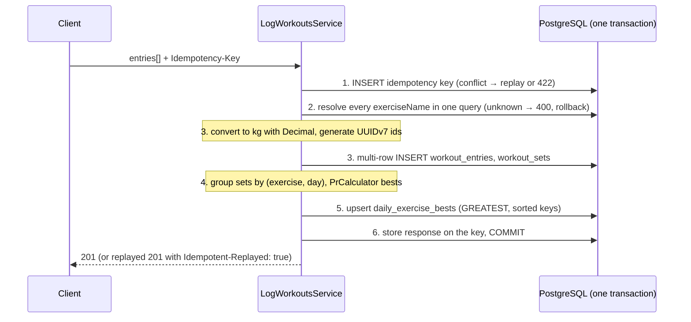

# Workout Logging API

REST API for logging strength workouts (bulk, mixed units), browsing history with filters and cursor pagination, and computing personal records with period comparison. NestJS + TypeScript, PostgreSQL 18, TypeORM.

- [Assumptions](#assumptions)
- [Time estimate vs actual](#time-estimate-vs-actual)
- [Quick start](#quick-start)
- [Architecture](#architecture)
- [API](#api)
- [Database](#database)
- [Timezone strategy](#timezone-strategy)
- [Unit extensibility](#unit-extensibility)
- [Concurrency and idempotency](#concurrency-and-idempotency)
- [Performance](#performance)
- [Testing](#testing)
- [Trade-offs, limitations and scale](#trade-offs-limitations-and-scale)
- [AI workflow](#ai-workflow)

Detailed references: [`docs/API.md`](docs/API.md) (endpoint contract), [`docs/SCHEMA.md`](docs/SCHEMA.md) (tables, indexes, write and read flows), [`docs/PERFORMANCE.md`](docs/PERFORMANCE.md) (measurements), [`docs/tasks/`](docs/tasks/) (spec per phase).

## Assumptions

- **Exercises are a curated catalog managed by an admin.** Users can only log exercises that exist in the catalog; unknown names are rejected with `400 UNKNOWN_EXERCISE` and nothing is saved. Name matching is case- and whitespace-insensitive (` bench  PRESS ` = `Bench Press`). In this project the catalog (66 exercises, 12 muscle groups) is seeded from [`config/exercise-metadata.json`](config/exercise-metadata.json); there is no admin API.
- `date` is a calendar date in the user's local timezone (`YYYY-MM-DD`), stored as `DATE`.
- Volume and PRs are computed per set. Estimated 1RM uses exactly the Epley formula from the assignment (`weight × (1 + reps / 30)`), including when `reps = 1`.
- PR ties are resolved by picking the earliest date the value was achieved.
- No update or delete of workout entries (outside the assignment scope).
- No authentication: `userId` is a path parameter; identity is owned by another service.
- Input limits: 1–100 entries per request, 1–50 sets per entry, reps 1–1000, weight with at most 4 decimals and `≤ 1000 kg` after conversion, dates on or after `1900-01-01`.

## Time estimate vs actual

The estimate was written on 2026-11-01, before starting implementation, and has not been changed.

| Phase | Scope | Estimate | Actual |
|---|---|---|---|
| 0 | Design & setup (estimate, schema, API contract, AI rules) | ~1h | 3h |
| 1 | Scaffold & production basics (NestJS layers, config, logging, error format, Docker) | ~2h | 2h |
| 2 | Pure domain + unit tests (units, PR calculator, normalization, dates, cursor) | ~1.5h | 1.5h |
| 3 | Database & exercise catalog (migration, seeder, `GET /exercises`) | ~1.5h | 2h |
| 4 | Log workout (bulk, idempotency, daily bests read model) | ~2h | 3h |
| 5 | History (filters, cursor pagination, unit conversion) | ~1.5h | 3h |
| 6 | Personal records (PR by range, period comparison with timezone) | ~1.5h | 3h |
| 7 | Integration tests, edge cases & performance | ~2h | 2h |
| 8 | Docs & final review | ~1.5h | 2h |
| | **Total** | **~14h** | **21.5h** |

## Quick start

Requirements: Docker with Compose. Nothing else is needed to run the API.

```bash
docker compose up --build
```

Compose starts PostgreSQL 18, runs the migrations (`migrate`) and the catalog seed (`seed-catalog`) as one-shot services, then starts the API on **http://localhost:3000**, base path `/api/v1`. PostgreSQL is published on host port 5432; set `DB_HOST_PORT=55432` (any free port) if 5432 is taken.

```bash
curl -s localhost:3000/api/v1/health
# {"status":"ok","db":"up"}
```

### Walkthrough

The commands below were run against a fresh stack; their output is reproduced with ids shortened to `…`. Ids and `loggedAt` differ on every run. The dates are fixed so the results do not depend on the day you run them.

**1. Bulk log**: one request, mixed units and aliases (`kg`, `lb`, `KGS`), the same exercise twice on 2026-11-02 under differently written names, and an `Idempotency-Key`.

```bash
BODY='{
  "entries": [
    { "date": "2026-10-14", "exerciseName": "Bench Press",
      "sets": [{ "reps": 5, "weight": 100, "unit": "kg" }, { "reps": 3, "weight": 105, "unit": "kg" }] },
    { "date": "2026-11-02", "exerciseName": "Bench Press",
      "sets": [{ "reps": 5, "weight": 225, "unit": "lb" }] },
    { "date": "2026-11-02", "exerciseName": "  bench PRESS ",
      "sets": [{ "reps": 10, "weight": 90, "unit": "KGS" }] }
  ]
}'
curl -s -X POST localhost:3000/api/v1/users/demo/workouts \
  -H 'Content-Type: application/json' -H 'Idempotency-Key: demo-1' -d "$BODY"
```

`201 Created`, every entry resolved to the catalog's `Bench Press` and every unit normalized:

```json
{"data":{"entries":[
  {"id":"…","date":"2026-10-14","exercise":{"id":1,"name":"Bench Press"},"sets":[
    {"id":"…","setIndex":1,"reps":5,"weight":100,"unit":"kg","weightKg":100},
    {"id":"…","setIndex":2,"reps":3,"weight":105,"unit":"kg","weightKg":105}]},
  {"id":"…","date":"2026-11-02","exercise":{"id":1,"name":"Bench Press"},"sets":[
    {"id":"…","setIndex":1,"reps":5,"weight":225,"unit":"lb","weightKg":102.06}]},
  {"id":"…","date":"2026-11-02","exercise":{"id":1,"name":"Bench Press"},"sets":[
    {"id":"…","setIndex":1,"reps":10,"weight":90,"unit":"kg","weightKg":90}]}]}}
```

**2. History in pounds, one entry per page.** Same-day entries come newest-logged first.

```bash
curl -s 'localhost:3000/api/v1/users/demo/workouts?unit=lb&limit=1'
```

```json
{"data":[{"id":"…","date":"2026-11-02","exercise":{"id":1,"name":"Bench Press"},
  "sets":[{"setIndex":1,"reps":10,"weight":90,"unit":"kg","converted":{"weight":198.42,"unit":"lb"}}],
  "loggedAt":"2026-11-02T07:33:57.812Z"}],
 "pageInfo":{"nextCursor":"eyJ2IjoxLCJkIjoiMjAyNi0xMS0wMiIs…","hasMore":true},"meta":{}}
```

Pass `pageInfo.nextCursor` back as `cursor` for the next page. The set logged as 225 lb converts back to exactly 225 lb, because output is converted from the original value, not from the stored kg:

```bash
curl -s "localhost:3000/api/v1/users/demo/workouts?unit=lb&limit=1&cursor=<nextCursor>"
```

```json
{"data":[{"id":"…","date":"2026-11-02","exercise":{"id":1,"name":"Bench Press"},
  "sets":[{"setIndex":1,"reps":5,"weight":225,"unit":"lb","converted":{"weight":225,"unit":"lb"}}],
  "loggedAt":"2026-11-02T07:33:57.812Z"}],
 "pageInfo":{"nextCursor":"…","hasMore":true},"meta":{}}
```

**3. Personal records**, all time. Without `unit`, each record keeps the unit of the set that achieved it.

```bash
curl -s 'localhost:3000/api/v1/users/demo/personal-records?exercise=bench%20press'
```

```json
{"data":{"exercise":{"id":1,"name":"Bench Press"},"range":{"from":null,"to":null},"records":{
  "maxWeight":{"value":105,"unit":"kg","weight":105,"reps":3,"achievedOn":"2026-10-14","setId":"…"},
  "maxVolume":{"value":900,"unit":"kg","weight":90,"reps":10,"achievedOn":"2026-11-02","setId":"…"},
  "bestEstimated1RM":{"value":120,"unit":"kg","weight":90,"reps":10,"achievedOn":"2026-11-02","setId":"…"}}},
 "meta":{}}
```

**4. Compare this month with last month** in the user's timezone. `anchor` is optional (default: today in `tz`); it is fixed here so the output is stable.

```bash
curl -s 'localhost:3000/api/v1/users/demo/personal-records/compare?exercise=Bench%20Press&period=month&tz=Asia/Ho_Chi_Minh&anchor=2026-11-15'
```

```json
{"data":{"exercise":{"id":1,"name":"Bench Press"},"unit":"kg",
  "current":{"range":{"from":"2026-11-01","to":"2026-11-30"},"records":{
    "maxWeight":{"value":102.06,"unit":"kg","weight":102.06,"reps":5,"achievedOn":"2026-11-02","setId":"…"},
    "maxVolume":{"value":900,"unit":"kg","weight":90,"reps":10,"achievedOn":"2026-11-02","setId":"…"},
    "bestEstimated1RM":{"value":120,"unit":"kg","weight":90,"reps":10,"achievedOn":"2026-11-02","setId":"…"}}},
  "previous":{"range":{"from":"2026-10-01","to":"2026-10-31"},"records":{
    "maxWeight":{"value":105,"unit":"kg","weight":105,"reps":3,"achievedOn":"2026-10-14","setId":"…"},
    "maxVolume":{"value":500,"unit":"kg","weight":100,"reps":5,"achievedOn":"2026-10-14","setId":"…"},
    "bestEstimated1RM":{"value":116.67,"unit":"kg","weight":100,"reps":5,"achievedOn":"2026-10-14","setId":"…"}}},
  "delta":{
    "maxWeight":{"absolute":-2.94,"percent":-2.8,"improved":false},
    "maxVolume":{"absolute":400,"percent":80,"improved":true},
    "bestEstimated1RM":{"absolute":3.33,"percent":2.9,"improved":true}}},
 "meta":{}}
```

**5. Retry with the same `Idempotency-Key`**: the stored response is replayed and nothing is written again.

```bash
curl -s -i -X POST localhost:3000/api/v1/users/demo/workouts \
  -H 'Content-Type: application/json' -H 'Idempotency-Key: demo-1' -d "$BODY" | grep -iE '^HTTP|idempotent-replayed'
# HTTP/1.1 201 Created
# Idempotent-Replayed: true
```

The same key with a different body is rejected:

```bash
curl -s -X POST localhost:3000/api/v1/users/demo/workouts \
  -H 'Content-Type: application/json' -H 'Idempotency-Key: demo-1' \
  -d '{"entries":[{"date":"2026-11-02","exerciseName":"Deadlift","sets":[{"reps":5,"weight":180,"unit":"kg"}]}]}'
```

```json
{"error":{"code":"IDEMPOTENCY_KEY_REUSED","message":"This Idempotency-Key was already used with a different request body","details":[]},"requestId":"…"}
```

**6. Errors list every problem with its field path:**

```bash
curl -s -X POST localhost:3000/api/v1/users/demo/workouts -H 'Content-Type: application/json' \
  -d '{"entries":[{"date":"2026-11-02","exerciseName":"Bech Press","sets":[{"reps":5,"weight":100,"unit":"kg"}]}]}'
```

```json
{"error":{"code":"UNKNOWN_EXERCISE","message":"One or more exercises are not in the catalog. Use GET /api/v1/exercises to find valid names.","details":[{"field":"entries[0].exerciseName","issue":"Unknown exercise 'Bech Press'"}]},"requestId":"…"}
```

### Running without Docker for the API

```bash
nvm use                        # Node 22 (.nvmrc)
npm ci
docker compose up -d db
cp .env.example .env           # adjust DATABASE_URL if DB_HOST_PORT is not 5432
npm run migration:run
npm run seed:catalog
npm run start:dev
```

## Architecture

The application is one stateless NestJS backend (the API) and one PostgreSQL 18 database; `docker compose up` runs both, plus one-shot `migrate` and `seed-catalog` jobs before the API starts.

Each module keeps controller → service → repository (TypeORM repositories, QueryBuilder where the Repository API is not enough). Pure logic (`PrCalculator`, `UnitConverter`, period computation, cursor encoding) has no Nest or database dependency and is unit-tested directly.

The layer rules are enforced by ESLint `import/no-restricted-paths`, so a violation fails `npm run lint`:

- `config/`, `common/`, `shared/`, `infrastructure/`, `health/` never import from `modules/`
- `shared/` never touches the database
- modules depend one way only: `workouts → catalog`, `workouts → personal-records`, `personal-records → catalog`
- `seeds/` (the catalog loader, run as a standalone script) may import modules, nothing imports seeds

### Write flow: `POST /users/:userId/workouts`



History reads `workout_entries`/`workout_sets`. PR endpoints read `daily_exercise_bests` and join `workout_sets` only for the winning set of each metric.

## API

Base path `/api/v1`. Full contract with every field rule and example: [`docs/API.md`](docs/API.md).

| Method | Path | Purpose |
|---|---|---|
| `POST` | `/users/:userId/workouts` | Log 1–100 entries atomically; optional `Idempotency-Key` |
| `GET` | `/users/:userId/workouts` | History, newest first; filters `exercise` (partial), `muscleGroup`, `from`/`to`; `unit` adds converted weights; cursor pagination (`limit`, `cursor`) |
| `GET` | `/users/:userId/personal-records` | Max weight, max volume, best estimated 1RM for one exercise, optional `from`/`to` and `unit` |
| `GET` | `/users/:userId/personal-records/compare` | PRs of two periods with delta: preset `period=week\|month\|year` + `tz` + `anchor`, or a custom pair of ranges |
| `GET` | `/exercises` | The catalog, filters `search` and `muscleGroup` |
| `GET` | `/health` | Liveness + database connectivity |

Successful responses wrap the payload in `data` (plus `pageInfo` for history and `meta` for messages such as empty results). Empty results are `200`, not errors. Every error has the same shape, `{ "error": { "code", "message", "details": [{ "field", "issue" }] }, "requestId" }`, and `details` lists every problem at once.

| Code | HTTP | When |
|---|---|---|
| `VALIDATION_ERROR` | 400 | Invalid body, query, path parameter or header (unsupported unit, invalid date, weight above the kg limit, malformed JSON, unknown field) |
| `UNKNOWN_EXERCISE` | 400 | `POST` body has an `exerciseName` that is not in the catalog |
| `INVALID_CURSOR` | 400 | The pagination cursor is malformed or tampered with |
| `EXERCISE_NOT_FOUND` | 404 | PR or PR comparison for an exercise that is not in the catalog |
| `NOT_FOUND` | 404 | The route does not exist |
| `CONFLICT` | 409 | A database constraint was violated with no more specific error |
| `IDEMPOTENCY_KEY_REUSED` | 422 | The same `Idempotency-Key` was sent with a different body |
| `INTERNAL_ERROR` | 500 | Unexpected error (no stack trace or database message in the body) |
| `SERVICE_UNAVAILABLE` | 503 | `GET /health` when the database is not reachable |

Every response carries `x-request-id` (the client's own value is reused, up to 128 characters), and the same id appears in the logs.

## Database

PostgreSQL 18. The schema is owned by a hand-written migration ([`0001-init.ts`](src/infrastructure/database/migrations/0001-init.ts)); TypeORM entities only map columns (no `synchronize`). Full description, index rationale and query shapes: [`docs/SCHEMA.md`](docs/SCHEMA.md).

| Group | Tables | Role |
|---|---|---|
| Exercise catalog (admin-owned) | `muscle_groups`, `exercises`, `exercise_muscle_groups` | Curated exercises and their many-to-many muscle-group mapping |
| Workout log (write model) | `workout_entries`, `workout_sets` | Immutable record of what was logged: original `weight` + `unit`, plus `weight_kg` for comparisons |
| PR statistics (read model) | `daily_exercise_bests` | One row per user, exercise and day with the best weight, volume and e1RM and the set that achieved each; rebuildable (`npm run rebuild:bests`) |
| Infrastructure | `idempotency_keys` | Request hash and stored response per `(user_id, key)` |

Key choices:

- **Name → `exercise_id` at log time**, so large tables hold a 4-byte key, renaming an exercise touches no workout data, and history filters by name or muscle group resolve a short id list on the small catalog first.
- **Keyset pagination** on `(performed_on DESC, id DESC)`, served by `entries_user_date` / `entries_user_exercise_date`. Ids are UUIDv7 (time-ordered): not guessable, append-mostly in B-trees, and same-day entries come out in logging order.
- **`NUMERIC(10,4)` weights**, never floats; `weight_kg` is computed once with `Decimal` and rounded to the column scale, so the application and the database hold the same value.
- **`daily_exercise_bests`** makes any PR range query read at most one row per training day, whatever the number of sets. Its primary key has no `INCLUDE` columns and the table uses `fillfactor = 90`, so the per-request upserts can be HOT updates.

## Timezone strategy

- **Workout days are `DATE`** (`performed_on`), the calendar date in the user's local timezone as sent by the client. No time of day is stored or inferred, so a workout at 23:30 in Hanoi stays on that day whatever the server's timezone.
- **System instants are `TIMESTAMPTZ` in UTC** (`created_at`, returned as `loggedAt`).
- **Dates are handled as `YYYY-MM-DD` strings** in the application; nothing calls `new Date('YYYY-MM-DD')` or local-time getters, and the rebuild job reads `DATE` columns with `to_char` so `pg` does not turn them into server-local `Date` objects.
- **Period comparison takes the user's `tz`** (IANA, default `UTC`). The timezone only decides which date is "today"; the period boundaries are then pure calendar arithmetic (luxon, weeks start on Monday). See [`src/shared/date/period.ts`](src/shared/date/period.ts).

Trade-offs: the API cannot know the exact time of a workout or reorder workouts within a day by time. "Future date" cannot be checked exactly without the user's timezone on the log request, so a date is accepted up to one day after the current UTC date (covers every timezone up to UTC+14), and a date that is tomorrow for the user in UTC−x can slip through.

## Unit extensibility

Units live in one data registry, [`src/shared/units/unit.registry.ts`](src/shared/units/unit.registry.ts): `{ code, kgPerUnit, aliases, reference }`. Request validation (and its error message), alias resolution (`LBS` → `lb`), conversion both ways and the registry unit tests are all derived from it; no other code compares against a specific unit.

Adding `stone`:

1. Add one entry: `{ code: 'stone', kgPerUnit: '6.35029318', aliases: ['st', 'stones'], reference: { value: '1', kg: '6.35029318' } }`.
2. Nothing else: the `unit` column is `TEXT` (no migration), the DTOs validate against the registry, and the registry tests check the new `reference` value automatically.

Rules:

- **Append-only.** Stored rows keep their original unit; removing an entry would leave rows that can no longer be validated or converted directly (output then falls back to `weight_kg`).
- **`kgPerUnit` is a string and all weight math uses `Decimal`.** `0.45359237` is not exact in binary floating point; with `number`, `PrCalculator`, the rebuild job and the `NUMERIC` values in PostgreSQL could disagree on ties. `weight_kg` is rounded half-up to 4 decimals, exactly the column scale; only API output is rounded to 2 decimals.
- **Output converts from the original `weight` + `unit`**, not from `weight_kg`, so 225 lb is returned as exactly 225 lb.
- The base unit (`BASE_UNIT_CODE`, default for PR comparison) is derived from the entry with `kgPerUnit: '1'`, not hardcoded.

## Concurrency and idempotency

- **One transaction per bulk request**: either every entry is saved or none is.
- **Idempotency**: the key is claimed with an `INSERT` on the `(user_id, key)` primary key as the first statement of the transaction. A retry with the same body (compared after validation and normalization, keys sorted) replays the stored status and body with `Idempotent-Replayed: true`; a different body returns `422`. A concurrent request with the same key blocks on the primary key until the first one commits (then replays) or rolls back (then proceeds). A failed request stores nothing, so the client can fix the body and retry with the same key. Keys are currently kept indefinitely.
- **Daily bests** are updated with one `INSERT … ON CONFLICT DO UPDATE` using `GREATEST` per metric, so two requests for the same day both end with the correct maximum without application locks or `SERIALIZABLE`. Rows are always upserted in `(exercise_id, performed_on)` order, so concurrent bulk requests cannot deadlock. This is covered by an e2e test with opposite-order concurrent requests.
- **Logging never inserts into `exercises`**, so there is no get-or-create race.

## Performance

Measured with **50 000 entries (~200 000 sets) for one user** plus 200 background users (1.8 M sets in total), through the real services and query builders. Full method, environment and plans: [`docs/PERFORMANCE.md`](docs/PERFORMANCE.md).

| Scenario | p50 | p95 |
|---|---|---|
| History, first page | 1.02 ms | 1.15 ms |
| History, page 2 001 (after 40 000 entries) | 1.14 ms | 1.55 ms |
| History, `exercise=press` | 1.47 ms | 1.94 ms |
| History, `muscleGroup=chest` | 1.57 ms | 1.97 ms |
| Personal records, all time | 1.98 ms | 2.24 ms |
| Compare `period=month` | 1.49 ms | 1.78 ms |

Every path stays under 2.5 ms p95 (warm cache, single client, database + ORM time without HTTP). The deep page costs the same as the first one, which is the point of keyset pagination; the PR query cost grows with the number of training days for the exercise, not with the number of sets.

```bash
DB_HOST_PORT=55432 docker compose up -d db   # then point DATABASE_URL in .env at that port
npm run migration:run && npm run seed:catalog
npm run seed:large                           # ~50 s, deterministic dataset
npm run perf:explain > perf.md               # timings + EXPLAIN (ANALYZE, BUFFERS) per query
```

## Testing

```bash
npm run lint        # ESLint, including the layer boundary rules
npm run typecheck
npm test            # unit tests, no database needed
npm run test:e2e    # end-to-end tests against a real PostgreSQL 18
```

The e2e suite needs a running **Docker** daemon: it starts one `postgres:18` container with Testcontainers, applies the migrations and seeds the catalog, then removes the container at the end. No manual database setup is needed. Node.js 22 is required (see `.nvmrc`).

Strategy:

- **Unit tests** (`*.spec.ts` next to the code) for pure logic, written test-first for the calculations: unit conversion against a fixed reference value per registry entry (a round-trip test would pass with a wrong factor), PR metrics with hand-computed expectations and ties, period boundaries across months, years and DST, cursor tampering, DTO validation messages.
- **E2E tests** ([`test/e2e/`](test/e2e/)) through HTTP against a real database: every endpoint and error code, atomic rollback on an unknown exercise, idempotent replay and concurrent same-key requests, history filters and pagination stability, PR ties and ranges, period comparison in a timezone, and that the rebuild job reproduces the incrementally maintained `daily_exercise_bests` row for row.
- **Concurrency test** for deadlocks: concurrent bulk requests touching 10 days in opposite order, 50 iterations. It is probabilistic (with both lock-ordering sorts removed it failed 2 runs out of 4), which the test documents.

## Trade-offs, limitations and scale

Trade-offs taken:

- **Curated catalog instead of free-text exercises**: clean data and referential integrity, at the cost of rejecting names the admin has not added.
- **Read model for PRs**: an extra upsert per logged day on the write path, in exchange for PR queries bounded by training days. It is derived data with no foreign keys on the `*_set_id` columns, kept consistent by the write flow and the rebuild job.
- **UUIDv7 instead of `BIGSERIAL`**: 16 bytes per id in every index, in exchange for non-guessable ids and stable same-day ordering.
- **One raw SQL statement in the app** (the daily bests upsert), because TypeORM's `orUpdate` cannot express a per-metric `GREATEST` with a conditional set id; everything else goes through repositories or QueryBuilder with bound parameters.

Known limitations:

- Synonyms are not resolved: `Barbell Bench Press` is rejected unless the admin adds it.
- Renaming an exercise in the seed file creates a **new** exercise (the seeder upserts by normalized name); the old one is kept because it may have history. Clients sending an old name get `UNKNOWN_EXERCISE`.
- When two concurrent requests log the **same best value** for the same exercise and day, the set that keeps the record is the one whose upsert ran first, while the rebuild job picks by transaction start time; the values are identical, only `setId` can differ.
- The rebuild job must not run while the same user is logging.
- An idempotent retry is validated again before the replay, so a retry of an entry dated "tomorrow" sent more than a day later gets `400` instead of the stored response.
- Idempotency keys are never purged.

What would change at scale (details in [`docs/SCHEMA.md`](docs/SCHEMA.md#what-would-change-at-scale)):

1. Cache the catalog and muscle-group mapping in memory or Redis.
2. Expire idempotency keys in batches through the `created_at` index (`pg_cron` or a scheduled job), or partition that table by time.
3. Split bulk logging and the daily bests calculation into two flows that communicate through a message queue. The log request only writes entries, sets and an outbox row in its transaction; a worker consumes the event and upserts `daily_exercise_bests`. The `GREATEST` upsert gives the same values whatever the delivery order and however many times an event is delivered, so the worker can retry freely (only the `setId` of a tie can depend on order). Cost: PRs become eventually consistent (they lag the log by the queue delay), and the rebuild job remains the recovery path.

## AI workflow

How Claude Code was used, where it was wrong, and which suggestions were rejected: [`AI_WORKFLOW.md`](AI_WORKFLOW.md).
