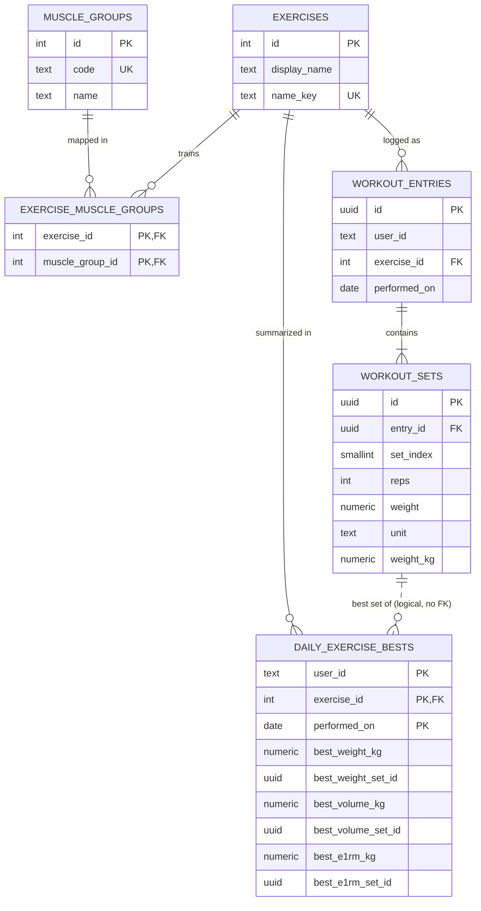

# Database Schema

PostgreSQL 18. All timestamps are stored in UTC (`TIMESTAMPTZ`); workout days are calendar dates (`DATE`) in the user's local timezone.

## Assumption: exercises are a curated catalog

- Exercises are **managed by an admin**. In this project the catalog is seeded from `config/exercise-metadata.json` (run automatically by `docker compose up`, which sets `SEED_CATALOG=true`); in production an admin tool would own it and the seeder would not run. An admin API is out of scope.
- Users cannot create exercises. A user can only log entries for exercises that already exist in the catalog.
- The log API accepts `exerciseName` (as the assignment requires) and **resolves it to `exercise_id`** before saving. Unknown names are rejected with `400 UNKNOWN_EXERCISE` and nothing is saved.
- Name matching is case- and whitespace-insensitive: `Bench Press`, `bench press` and ` BENCH  PRESS ` all resolve to the same exercise.

## Overview

| Group | Tables | Role |
|---|---|---|
| Exercise catalog (admin-owned) | `muscle_groups`, `exercises`, `exercise_muscle_groups` | Curated exercises and their configurable muscle-group mapping |
| Workout log (write model) | `workout_entries`, `workout_sets` | Raw, immutable record of what the user logged |
| PR statistics (read model) | `daily_exercise_bests` | Derived per-day bests used by the PR endpoints; rebuildable from the workout log |
| Infrastructure | `idempotency_keys` | Deduplicates retried / double-submitted requests |



---

## Tables

### `muscle_groups`

| Column | Type | Constraints | Description |
|---|---|---|---|
| `id` | `SERIAL` | PK | |
| `code` | `TEXT` | NOT NULL, UNIQUE | Stable identifier used in the API, e.g. `chest` |
| `name` | `TEXT` | NOT NULL | Display name, e.g. `Chest` |

### `exercises`

| Column | Type | Constraints | Description |
|---|---|---|---|
| `id` | `SERIAL` | PK | |
| `display_name` | `TEXT` | NOT NULL | Name entered by the admin and shown to users, e.g. `Bench Press` |
| `name_key` | `TEXT` | NOT NULL, UNIQUE | `normalize(display_name)`: lowercase, trimmed, single spaces, e.g. `bench press`. Used to resolve `exerciseName` from requests and for search |
| `created_at` | `TIMESTAMPTZ` | NOT NULL, default `now()` | |
| `updated_at` | `TIMESTAMPTZ` | NOT NULL, default `now()` | |

`name_key` is computed by the application with the same normalization function used to resolve request names, so the rule lives in one place. The UNIQUE constraint prevents two exercises that users could not tell apart.

### `exercise_muscle_groups`

| Column | Type | Constraints | Description |
|---|---|---|---|
| `exercise_id` | `INT` | PK, FK → `exercises.id` ON DELETE CASCADE | |
| `muscle_group_id` | `INT` | PK, FK → `muscle_groups.id` ON DELETE CASCADE | |

An exercise may train several muscle groups (bench press → chest, triceps, shoulders) or none yet; an exercise without muscle groups can still be logged, it just won't match a muscle-group filter.

### `workout_entries`

One row = one exercise performed in one session on one day. A bulk request creates several entries in a single transaction.

| Column | Type | Constraints | Description |
|---|---|---|---|
| `id` | `UUID` | PK, default `uuidv7()` | Time-ordered UUIDv7. Also the tiebreaker for cursor pagination |
| `user_id` | `TEXT` | NOT NULL | No users table: identity is owned by another service (no auth in scope) |
| `exercise_id` | `INT` | NOT NULL, FK → `exercises.id` ON DELETE RESTRICT | Resolved from `exerciseName` at log time |
| `performed_on` | `DATE` | NOT NULL | Calendar date in the user's local timezone |
| `created_at` | `TIMESTAMPTZ` | NOT NULL, default `now()` | When the system recorded it (UTC) |

`ON DELETE RESTRICT`: an exercise that has workout history cannot be deleted, so history is never orphaned.

There is intentionally **no** unique constraint on `(user_id, exercise_id, performed_on)`: the same exercise can legitimately be logged twice in one day. Duplicate submissions are handled by `idempotency_keys`.

### `workout_sets`

| Column | Type | Constraints | Description |
|---|---|---|---|
| `id` | `UUID` | PK, default `uuidv7()` | Time-ordered UUIDv7 |
| `entry_id` | `UUID` | NOT NULL, FK → `workout_entries.id` ON DELETE CASCADE | |
| `set_index` | `SMALLINT` | NOT NULL, UNIQUE with `entry_id` | Order within the entry (1, 2, 3...) |
| `reps` | `INT` | NOT NULL, CHECK `> 0` | |
| `weight` | `NUMERIC(10,4)` | NOT NULL, CHECK `>= 0` | Original value as entered (0 = bodyweight) |
| `unit` | `TEXT` | NOT NULL | Original unit, validated against the app's unit registry |
| `weight_kg` | `NUMERIC(10,4)` | NOT NULL, CHECK `>= 0` | Normalized value used for all comparisons |

### `daily_exercise_bests`

Best performance per user, exercise and day. Every PR query reads from this table only.

| Column | Type | Constraints | Description |
|---|---|---|---|
| `user_id` | `TEXT` | PK | |
| `exercise_id` | `INT` | PK, FK → `exercises.id` | |
| `performed_on` | `DATE` | PK | |
| `best_weight_kg` | `NUMERIC(10,4)` | NOT NULL | Heaviest set of the day |
| `best_weight_set_id` | `UUID` | NOT NULL | Set that achieved it (logical reference, no FK) |
| `best_volume_kg` | `NUMERIC(12,4)` | NOT NULL | Highest `reps × weight_kg` of the day |
| `best_volume_set_id` | `UUID` | NOT NULL | Logical reference, no FK |
| `best_e1rm_kg` | `NUMERIC(10,4)` | NOT NULL | Highest Epley estimate `weight_kg × (1 + reps / 30)` of the day |
| `best_e1rm_set_id` | `UUID` | NOT NULL | Logical reference, no FK |

The table is created `WITH (fillfactor = 90)`: every log request upserts into it, and the free space left in each page lets those updates stay on the same page as HOT updates (see `daily_bests_pk` below).

The `*_set_id` columns deliberately have no foreign key: this table is derived data and is kept consistent by the write flow and the rebuild job, not by constraints. Without FKs, deleting entries (if added later) is not blocked by this table; the affected day is recomputed instead.

### `idempotency_keys`

| Column | Type | Constraints | Description |
|---|---|---|---|
| `user_id` | `TEXT` | PK | |
| `key` | `TEXT` | PK | Value of the `Idempotency-Key` header |
| `request_hash` | `TEXT` | NOT NULL | SHA-256 of the **canonicalized** request body (object keys sorted recursively, array order preserved). Detects a reused key with a different body (→ 422) without false positives from key ordering |
| `response_status` | `SMALLINT` | | HTTP status of the original response, replayed together with the body |
| `response` | `JSONB` | | Stored response body replayed on retry |
| `created_at` | `TIMESTAMPTZ` | NOT NULL, default `now()` | Keys older than 24h are purged by a cleanup job |

---

## Indexes

Extension: `pg_trgm`.

| Index | Definition | Serves |
|---|---|---|
| `exercises_name_key_uq` | `UNIQUE (name_key)` | Resolving `exerciseName` → `exercise_id` at log time |
| `exercises_name_key_trgm` | GIN `(name_key gin_trgm_ops)` | Partial-match exercise search (`LIKE '%press%'`) |
| `emg_muscle_group` | `(muscle_group_id, exercise_id)` | "Which exercises train the chest?" |
| `entries_user_date` | `(user_id, performed_on DESC, id DESC)` | History without exercise filter + keyset pagination |
| `entries_user_exercise_date` | `(user_id, exercise_id, performed_on DESC, id DESC)` | History filtered by exercise (exact or partial) or muscle group |
| `sets_entry` | `UNIQUE (entry_id, set_index)` | Loading sets of a page of entries |
| `daily_bests_pk` | `PRIMARY KEY (user_id, exercise_id, performed_on)` | PR and PR comparison over any date range |
| `idempotency_created_at` | `(created_at)` | Cleanup job |

`daily_bests_pk` has no `INCLUDE` columns: the `best_*` columns are updated by every upsert, and keeping them out of the index lets those updates be HOT (no index write), and the table's `fillfactor = 90` leaves room in each page for the new row version. Rows per `(user, exercise)` are bounded by the number of training days, so reading the heap is cheap.

Name and muscle-group filters are both resolved against the small catalog first, producing a short list of `exercise_id`s; the large `workout_entries` table is then read only through `(user_id, exercise_id, ...)`. `(performed_on, id)` is the pagination key because many entries can share the same date; `id` makes the order total and stable. Because ids are UUIDv7 (time-ordered), entries on the same date come out newest-logged first, the same order a sequence would give. A random UUIDv4 would also paginate correctly but would order same-day entries randomly.

---

## Write flow (POST bulk log)

All steps run in **one transaction**:

1. Insert the idempotency key (if provided). On conflict: replay the stored `response_status` + `response` (same hash) or return 422 (different hash). A concurrent request with the same key blocks on the primary key until the first transaction commits (then replays) or rolls back (then proceeds).
2. Normalize every `exerciseName` in the request and resolve them **in one query** (`WHERE name_key = ANY($1)`). If any name is unknown, return `400 UNKNOWN_EXERCISE` listing every unknown name with its field path (e.g. `entries[2].exerciseName`) and save nothing.
3. Convert every set to kg via `UnitConverter`; generate UUIDv7 ids for every entry and set in the application, then insert `workout_entries` and `workout_sets` with one multi-row statement each. Because ids are known before the insert, sets reference their entry and step 4 references the winning sets without reading anything back (`RETURNING`).
4. Group the request's sets by `(exercise_id, performed_on)` **in the application** and compute per-group bests with `PrCalculator` (the only place where PR formulas live).
5. Upsert one row per group into `daily_exercise_bests`, keeping the greater value per metric with `GREATEST(...)` and swapping the `*_set_id` only when the new value is strictly greater. Groups are upserted **sorted by `(exercise_id, performed_on)`** so concurrent bulk requests touching the same days always lock rows in the same order and cannot deadlock.
6. Store the response status and body on the idempotency key and commit.

Step 4 is required: a single multi-row `INSERT ... ON CONFLICT DO UPDATE` cannot touch the same row twice, which would happen if one request logs the same exercise twice on the same day.

Logging never inserts into `exercises`, so there is no get-or-create race.

## Read flows

**History filtered by partial name or muscle group:** resolve matching `exercise_id`s from the catalog, then read entries.

```sql
SELECT e.*
FROM workout_entries e
WHERE e.user_id = $1
  AND e.exercise_id IN (
    SELECT emg.exercise_id
    FROM exercise_muscle_groups emg
    JOIN muscle_groups mg ON mg.id = emg.muscle_group_id
    WHERE mg.code = $2
  )
ORDER BY e.performed_on DESC, e.id DESC
LIMIT $3;
```

Partial name match works the same way with `SELECT id FROM exercises WHERE name_key LIKE '%' || $2 || '%' ESCAPE '\'` as the subquery. Before binding, the search term goes through the same `normalize()` used for `name_key` (so `"Bench  Press"` matches `bench press`; plain `LIKE` suffices because both sides are lowercase), and `\`, `%`, `_` are escaped so they match literally (otherwise `_` would match every exercise).

**PR for one exercise:** for each metric, pick the best day in the range, earliest date on ties.

```sql
SELECT performed_on, best_e1rm_kg, best_e1rm_set_id
FROM daily_exercise_bests
WHERE user_id = $1 AND exercise_id = $2
  AND performed_on BETWEEN $3 AND $4
ORDER BY best_e1rm_kg DESC, performed_on ASC
LIMIT 1;
```

The winning `*_set_id` gives the exact reps × weight without recomputation. PR comparison runs the same query for two ranges; range boundaries are computed in the application from the user's timezone.

---

## Unit extensibility

- **One registry is the single source of truth.** Units are declared as data, `{ code, kgPerUnit, aliases, reference }`, and everything else is derived from it: request validation (supported codes and the error message), alias resolution (`LBS` → `lb`), conversion in both directions, and the unit tests (each entry's `reference` value is checked against its expected kg). No code outside the registry compares against a specific unit.
- **`weight_kg` is produced only by `toStoredKg()`.** It multiplies with `Decimal` (never `number`) and rounds to the column scale (4 decimal places, half-up), so the value computed in the application is exactly the value stored.
- **Output is converted from the original `weight` + `unit`**, not from `weight_kg`, so 225 lb comes back as exactly 225 lb and converts without accumulating the storage rounding. If the original unit is no longer in the registry, conversion falls back to `weight_kg`.
- **Units are append-only.** Removing a unit from the registry would leave stored rows whose `unit` can no longer be validated or converted from directly; only additions are allowed.
- **Adding `stone`:** add one registry entry (`code: 'stone'`, `kgPerUnit: '6.35029318'`, aliases, a reference value). No migration (the `unit` column is `TEXT`), no DTO or converter change; the registry tests pick up the new entry automatically.

---

## Design decisions

- **PostgreSQL over MongoDB:** relational catalog with configurable many-to-many mappings, aggregation-heavy reads, exact `NUMERIC`, native `DATE`, ACID transactions without replica-set setup, `pg_trgm` for indexed partial match.
- **Curated catalog + `exercise_id` on entries:** referential integrity (no orphaned or misspelled exercises), compact rows on the large tables, and an admin can rename an exercise (`display_name`) without touching any workout data. The API still accepts `exerciseName` as the assignment specifies; the name → id resolution happens once per request.
- **Unknown names are rejected, not auto-created:** keeps the catalog clean and avoids inventing business rules for unmanaged exercises. Clients can discover valid names via `GET /exercises`.
- **UUIDv7 ids for workout data:** ids exposed by the API are not guessable and do not reveal how many workouts exist; UUIDv7 is time-ordered, so B-tree inserts stay append-mostly (unlike random UUIDv4, which splits pages all over the index) and same-day pagination order matches logging order. Cost: 16 bytes instead of 8 per id, in every index that contains it. Columns default to PostgreSQL 18's native `uuidv7()` (used by seeds, scripts and any other insert path); the bulk-log write flow generates UUIDv7 ids in the application instead, so it can link sets to entries and bests to sets without relying on the row order of a multi-row `INSERT ... RETURNING`, which PostgreSQL does not guarantee. Catalog tables (`exercises`, `muscle_groups`) keep `SERIAL` ids: they are small, admin-owned and referenced from the large tables, where a 4-byte key keeps rows compact.
- **Original + normalized weight:** `weight`/`unit` preserve user input exactly (225 lb is returned as 225 lb), `weight_kg` is used for every comparison. Rounding happens only in API responses.
- **`unit` as `TEXT`, not ENUM/CHECK:** adding a unit (e.g. stone) needs one line in the code registry and no migration.
- **Muscle groups are data, not code:** the mapping lives in tables, not in business logic, so changing it needs no code change; history filters always reflect the current mapping because entries reference `exercise_id` rather than copying muscle groups.
- **Write model vs read model:** `workout_entries`/`workout_sets` are the immutable source of truth; `daily_exercise_bests` is derived and rebuildable. Daily granularity supports arbitrary date ranges, and if entry deletion is added later only the affected day needs recomputing.
- **Concurrency:** handled by primary keys, `ON CONFLICT` and row-level atomic upserts. No application locks and no `SERIALIZABLE` isolation.

## Known limitations

- Users must send a name that matches a catalog entry after normalization. Synonyms (`Barbell Bench Press` vs `Bench Press`) are rejected unless the admin adds them.
- Renaming an exercise changes its `name_key`, so clients sending the old name will start receiving `UNKNOWN_EXERCISE`.

## What would change at scale

- Add an `exercise_aliases` table (alias → `exercise_id`) so synonyms and old names keep resolving after a rename.
- Accept `exerciseId` in the log request as an alternative to `exerciseName`, so clients that already picked from the catalog skip name resolution.
- Hash-partition `workout_entries` and `daily_exercise_bests` by `user_id` (every query filters by user, so partition pruning applies). Partitioning `workout_sets` the same way first requires denormalizing `user_id` onto it (and making the entries key `(user_id, id)`); this is deliberately deferred. Citus if a single node is not enough.
- Add an all-time `personal_records` cache table if PR dashboards dominate traffic, updated in the same transaction and rebuildable from `daily_exercise_bests`.
- Cache the exercise catalog and muscle-group mapping in memory or Redis with invalidation on change.
